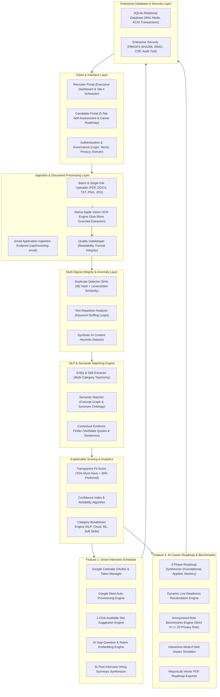
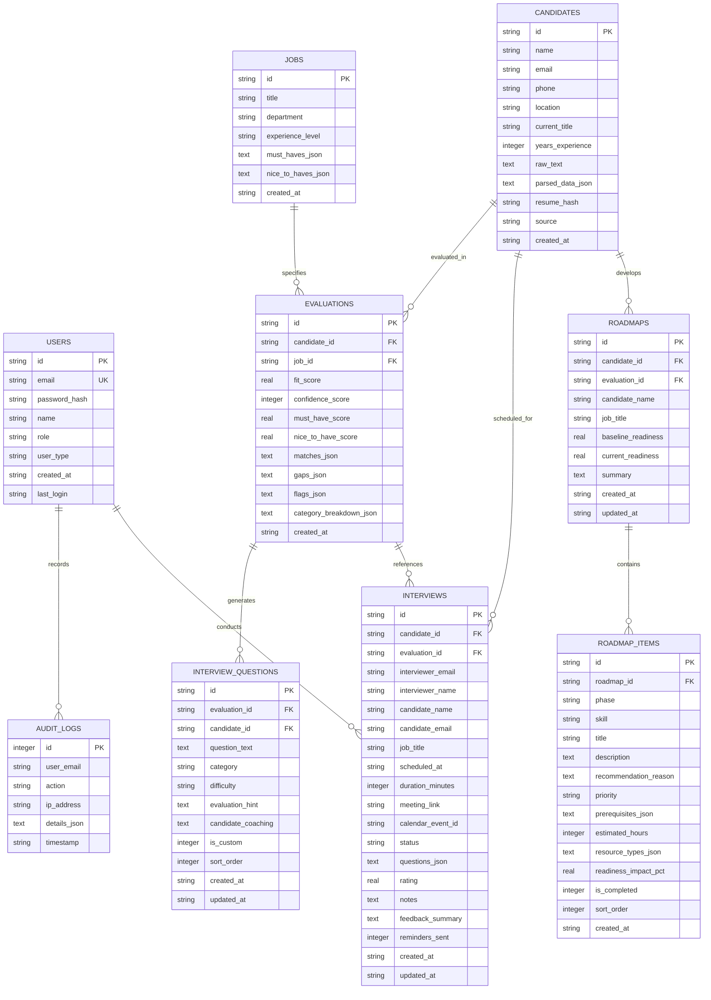

# Resume Matcher Enterprise: Intelligent Candidate Qualification & Interview Platform

A modern, enterprise-grade AI-powered resume and job description matching portal designed for high-volume recruitment. Engineered specifically to solve the data science recruitment challenge of processing 500+ resumes daily through semantic understanding, explainable match scoring, automated gap detection, adaptive interview question synthesis, smart calendar scheduling, personalized career readiness roadmaps, and enterprise-grade security.

---

## Table of Contents
1. [The Problem & Mission](#the-problem--mission)
2. [System Architecture](#system-architecture)
3. [Entity Relationship Diagram (ERD)](#entity-relationship-diagram-erd)
4. [Unique Competitive Advantages](#unique-competitive-advantages)
5. [Feature 1: Smart Interview Scheduling (Google Calendar & Meet)](#feature-1-smart-interview-scheduling-google-calendar--meet)
6. [Feature 2: AI Career Roadmap & Anonymized Role Benchmarks](#feature-2-ai-career-roadmap--anonymized-role-benchmarks)
7. [Complete Website Walkthrough](#complete-website-walkthrough)
8. [Dual-Engine AI Question Synthesis](#dual-engine-ai-question-synthesis)
9. [Enterprise Security & Governance](#enterprise-security--governance)
10. [REST API v1 Reference](#rest-api-v1-reference)
11. [Technology Stack](#technology-stack)
12. [Local Setup & Testing Guide](#local-setup--testing-guide)

---

## The Problem & Mission

### The Challenge
A data science hiring manager or lead recruiter receives 500+ resumes per day for competitive technical positions. Traditional applicant tracking systems (ATS) suffer from critical failure modes:
- **Keyword Blindness**: Rejecting qualified candidates who write "PyTorch Distributed Data Parallel" because the job description requested "Horovod" or "Distributed Training".
- **Keyword Stuffing Vulnerability**: Passing unqualified candidates who paste hidden white-text keywords or spam repeated acronyms.
- **Black-Box Scoring**: Presenting arbitrary percentages without proof, context, or actionable reasoning.
- **Generic Questionnaires**: Handing interviewers boilerplate interview questions that fail to probe the candidate's actual requirement gaps.
- **Disjointed Interview Scheduling**: Manual back-and-forth emails between recruiters and candidates, missing video links, and lack of pre-populated interview rubrics.
- **Lack of Candidate Growth Guidance**: Rejecting candidates without actionable development roadmaps or clear indications of what competencies they need to master.

### The Solution
Resume Matcher Enterprise replaces crude keyword matching with a natural language processing (NLP) concept graph, transparent mathematical scoring, multi-signal integrity auditing, native Apple Vision OCR, adaptive AI interview question generation tailored strictly to each candidate's missing competencies, integrated Google Calendar/Meet scheduling, and a 3-phase AI Career Readiness Roadmap with strict privacy-safeguarded role benchmarks.

---

## System Architecture

The application is structured into decoupled, modular layers with clear separation of concerns:



---

## Entity Relationship Diagram (ERD)

The database schema is hosted on persistent SQLite with Write-Ahead Logging (`WAL`), relational foreign keys (`PRAGMA foreign_keys = ON;`), and indexed lookup fields.



### Table Specifications

| Table | Purpose | Key Constraints |
|---|---|---|
| `users` | User credentials, roles, and access tiers | `id` PK, `email` UNIQUE, PBKDF2-SHA256 hashed passwords |
| `jobs` | Target job descriptions and requirements | `id` PK, structured JSON for must-have and preferred requirements |
| `candidates` | Extracted candidate dossiers and metadata | `id` PK, `resume_hash` for duplicate checking, `source` tracking |
| `evaluations` | Candidate match results against target jobs | `id` PK, `candidate_id` FK, `job_id` FK, breakdown metrics |
| `interview_questions` | Dynamic AI and custom interview questions | `id` PK (candidate-scoped), `candidate_id` FK, sort ordering |
| `interviews` | Scheduled interviews, Google Calendar events, ratings, AI summaries | `id` PK, `candidate_id` FK, `calendar_event_id`, status check |
| `roadmaps` | Multi-phase career progression roadmaps | `id` PK, `baseline_readiness`, `current_readiness`, role target |
| `roadmap_items` | Individual milestones, estimated hours, rationales, completion toggle | `id` PK, `roadmap_id` FK, `phase`, `is_completed` boolean |
| `audit_logs` | Immutable audit trail for security operations | `id` Auto-increment PK, records actor, action, IP, timestamp |

---

## Unique Competitive Advantages

### 1. Conceptual Semantic Graph vs. Keyword Counting
Standard ATS tools fail when technical terminology varies. Resume Matcher incorporates an ontological semantic map connecting related concepts:
- `PyTorch` is semantically recognized as equivalent or transferable to `Deep Learning Frameworks`, `TensorFlow`, and `Neural Network Engineering`.
- `AWS SageMaker` connects to `Managed ML Platforms`, `Vertex AI`, and `Kubeflow`.
- `PostgreSQL` satisfies relational database and data warehousing prerequisites.
- Negative matches identify context (e.g., "familiar with concepts" vs. "led 4-year production implementation").

### 2. 100% Mathematical Explainability (Zero Black Box)
The system calculates a deterministic, fully auditable match score:
- **70% Weight**: Must-Have Requirements.
- **30% Weight**: Preferred / Nice-to-Have Qualifications.
- **Side-by-Side Evidence**: Every verified match links directly to verbatim resume excerpts and matching job description requirements.
- **Confidence Index**: A calculated reliability score (0-100%) factoring document extraction quality, sentence completeness, and semantic density.

### 3. Dual-Engine AI Question Synthesis Without Canned Templates
Most platforms offer static, generic interview questions. Resume Matcher constructs questions anchored directly in the candidate's verified technical deficiencies:
- **Local AI Engine**: Operates completely offline with zero external network dependencies, generating challenging scenario-based questions from candidate requirement gaps.
- **Gemini AI Integration**: Enables high-tier generative refinement when an enterprise API key is provided.
- **Single-Question Regeneration**: Recruiters can regenerate an individual question card without disturbing the rest of the interview plan.
- **Recruiter Rubrics & Candidate Coaching**: Every question includes interviewer evaluation criteria and strategic STAR-method candidate coaching advice.

### 4. Smart Calendar Scheduling with Google Meet Integration
Recruiters can schedule interviews directly within the candidate deep-dive modal:
- Available slots are suggested from the recruiter's calendar.
- Google Meet links are generated and saved to the database.
- Candidate-specific AI interview questions from Tab 4 are embedded into the calendar invite with evaluation rubrics.
- Evaluators can submit numerical ratings (1.0 to 5.0) and unstructured notes to generate an executive AI post-interview hiring summary (`Strong Hire`, `Hire`, `Leaning Hire`, `No Hire`).

### 5. AI Career Roadmap & Privacy-Gated Role Benchmarks
Candidates receive a 3-phase sequential learning roadmap directly addressing their requirement gaps:
- Foundational Core (0 - 30 days) -> Applied Engineering (30 - 60 days) -> Interview-Ready Mastery (60 - 90 days).
- Live interactive progress bar and readiness score gauge recalculate dynamically upon checking milestones.
- What-If Simulator provides instant projections of match score improvements.
- Role benchmarks enforce a strict $N \ge 20$ sample-size threshold: if fewer than 20 candidates have been evaluated for the role, the platform displays an informational privacy notice and zero individual candidate records are exposed.
- Vector PDF export generates a printable development guide via ReportLab.

---

## Feature 1: Smart Interview Scheduling (Google Calendar & Meet)

Feature 1 transforms the recruiter assessment workflow by embedding interview coordination directly into the evaluation modal:

### Key Capabilities
1. **Schedule Interview Button & Status Banner**:
   - Located prominently in Tab 4 (Targeted Mock Interview Questions) of the Recruiter Assessment modal.
   - Active interview status card displays date/time, interviewer email, Google Meet button, Reschedule, Cancel, Reminder, and Submit Feedback actions.
2. **Calendar OAuth2 & Sandbox Mode**:
   - Production support for Google Calendar OAuth2 (`google-auth-oauthlib`).
   - Built-in Enterprise Sandbox Connect allows 1-click test connections during demonstrations.
3. **Automated Slot Suggestions**:
   - Analyzes the recruiter's calendar for the selected target date.
   - Filters out already-booked interviews and presents 1-click selectable time chips (`09:30 AM`, `11:00 AM`, `02:00 PM`, `03:30 PM`, `05:00 PM`).
4. **Auto-Embedded AI Questions**:
   - The event description automatically includes candidate metadata, match score, and candidate-specific AI questions synthesized from requirement gaps.
   - Recruiter rubrics and evaluation criteria are embedded directly into the invite body.
5. **Interview Lifecycle APIs**:
   - Full REST API suite: Schedule (`POST`), List (`GET`), Reschedule (`PUT`), Cancel (`POST`), Send Reminder (`POST`), and Feedback (`POST`).
   - Restricted strictly to HR Assessors via `@role_required(['hr'])`.
6. **AI Post-Interview Feedback Summary**:
   - After conducting the interview, the assessor inputs a numerical rating (1.0 to 5.0) and observations.
   - Built-in AI synthesizes notes, ratings, and original gaps into an executive recommendation (`Strong Hire`, `Hire`, `Leaning Hire`, `No Hire`) saved to the database.

---

## Feature 2: AI Career Roadmap & Anonymized Role Benchmarks

Feature 2 provides candidates with an AI-driven, actionable career development curriculum formulated directly from their identified skill gaps:

### Key Capabilities
1. **5-Tab Candidate Navigation System**:
   - Candidate mode features 5 organized tabs: Executive Overview, Verified Matches, Skill Gaps, Mock Interview Questions, and Your Career Roadmap & Role Benchmarks.
2. **3-Phase Structured Progression**:
   - **Phase 1: Foundational Core (0 - 30 Days)**: Theoretical prerequisites, syntax fundamentals, and core concepts.
   - **Phase 2: Applied Engineering (30 - 60 Days)**: Production pipelines, containerized deployments, cloud services, and hands-on portfolio code.
   - **Phase 3: Interview-Ready Mastery (60 - 90 Days)**: Architectural trade-offs, CAP theorem considerations, failure mode mitigation, and mock interview defense.
3. **Milestone Tracking & Live Readiness Gauge**:
   - Each milestone specifies priority (`CRITICAL`, `HIGH`, `MEDIUM`), estimated study hours, resource types, and expected readiness impact (+X%).
   - Checking a milestone calls `PATCH /api/v1/roadmaps/items/<id>/toggle` and updates the candidate's live readiness score and progress bar in real time without a page refresh.
4. **"Why this recommendation?" Expandable Rationales**:
   - Every milestone card contains an expandable details accordion articulating exactly why this recommendation was formulated and how it bridges the specific gap.
5. **Interactive What-If Simulator**:
   - Candidates can select any missing skill from a dropdown and project the impact of mastering it.
   - Displays projected match score boost, cohort percentile shift, and recommended immediate next steps.
6. **Anonymized Role Benchmarks ($N \ge 20$ Privacy Safeguard)**:
   - Evaluates the candidate against the statistical distribution of peer applicants for the same role.
   - **Strict Privacy Rule**: If the role cohort sample size $N < 20$, the system displays: `"Not enough data (minimum 20 candidates required to calculate anonymized statistical percentiles)"`.
   - When $N \ge 20$, displays cohort size, candidate percentile (e.g. Top 15%), median fit score, 75th percentile threshold, and top in-demand skills.
   - Zero candidate names, emails, or individual scores are exposed.
7. **ReportLab Vector PDF Export**:
   - Generates a downloadable, corporate-styled Career Readiness Roadmap PDF complete with progress metrics, phase breakdowns, and milestone checklists.

---

## Complete Website Walkthrough

### 1. Navigation & Role Switcher
- **Executive Brand Header**: Clean dark-mode navbar displaying system status, active target job, and role portal indicator.
- **Portal Mode Toggle**: Switch between `Recruiter Mode` and `Candidate Mode` with a single click.
- **Quick Actions**:
  - `Ingest Application Email`: Opens the streamlined email parsing modal.
  - `Manage Active Target JD`: Switch or upload new job descriptions.
  - `Sign In / Portals`: Direct access to HR Recruiter and Candidate login workspaces.

### 2. Recruiter Mode: Candidate Management Table
- **Candidate Dossier Table**: Displays Candidate Name, File Type, Match Score Circle, Reliability Index, Matches/Gaps count pill groups, Integrity Review Flags, and Action Buttons (`Assess`, `Download PDF`).
- **Real-Time Search & Filter**: Filter candidates by score tiers (`All Candidates`, `High Fit (80%+)`, `Moderate (50-79%)`, `Low (<50%)`, `Flagged for Review`).
- **Immediate Batch Upload**: Drag-and-drop or select multiple resumes (PDF, DOCX, TXT, PNG, JPG) with instant processing and real-time counter updates.

### 3. Candidate Deep-Dive Assessment Modal
Clicking on any candidate row or the `Assess` button opens the modal:
- **Header Profile**: Candidate coordinates (Name, Email, Phone, Location, Source) and one-click PDF Dossier export.
- **Hero Metrics**: Circular score ring, Reliability Index, and formula explanation.
- **Tab 1: Requirement-by-Requirement Matrix**: Side-by-side comparison of every target requirement with status tags (`MATCH`, `PARTIAL`, `GAP`), verbatim resume evidence quotes, and analytical rationale.
- **Tab 2: Structured Candidate Profile**: Automatically categorized skill buckets (Programming, Frameworks, Cloud, Databases, AI/ML, DevOps), education history, and professional experience timelines.
- **Tab 3: Integrity & Risk Review**: Flags for duplicate submissions, repeated text stuffing, and synthetic text markers.
- **Tab 4: Targeted Mock Interview Questions & Smart Scheduling**:
  - 7 to 10 dynamically generated questions addressing the candidate's gaps.
  - Question toolbar: `[AI Regen]`, `[Edit]`, `[Delete]`, and `[Copy]`.
  - `[AI Customize Plan]`: Adjust seniority level, volume (5, 7, 10, 12, 15), and custom prompt directives.
  - `[Schedule Interview]`: Open Google Calendar & Meet scheduling modal with suggested available slots.
  - Active Interview Banner: Join Google Meet, Reschedule, Cancel, Send Reminder, and Submit Feedback.

### 4. Candidate Self-Assessment Mode
- **Dual Input Interface**:
  - Panel 1: Upload candidate resume (file upload, drag-and-drop, or text paste).
  - Panel 2: Select target role from standard library (Senior Data Scientist, ML Platform Engineer, BI & Data Analyst) or paste custom job requirements.
- **5-Tab Navigation Layout**:
  - **Tab 1: Executive Overview**: Match score gauge, confidence rating, matches count, and gap overview.
  - **Tab 2: Verified Matches**: Full evidence quotes and verified production claims.
  - **Tab 3: Skill Gaps**: Specific missing requirements and identified deficiencies.
  - **Tab 4: Mock Interview Questions**: Gap-anchored technical questions with candidate answer strategies (STAR method) and PDF export.
  - **Tab 5: Your Career Roadmap & Role Benchmarks**: Live readiness score gauge, progress bar, 3-phase milestone checklist with completion toggles, "Why this recommendation?" rationales, interactive What-If simulator, privacy-safeguarded role benchmarks ($N \ge 20$), and vector PDF export.

### 5. Streamlined Application Email Ingestion Modal
- **Clean Layout**: Designed for rapid ingestion without clutter.
- **1-Click Demo Buttons**: Pre-loads complete email applications for testing (Elena Vance, David Kim, Sophie Taylor).
- **Unified Text Area**: Paste raw applicant email text, cover letters, or resume text.
- **Optional File Attachment**: Drop or browse PDF, DOCX, or Image files.
- **Automatic Extraction**: System auto-detects sender email, subject, target role, and technical competencies without mandatory manual typing.

---

## Dual-Engine AI Question Synthesis

The interview generator operates under a dual-engine architecture:

```
+-----------------------------------------------------------------------+
|                 Dual-Engine AI Question Synthesizer                   |
+-----------------------------------------------------------------------+
                                    |
            +-----------------------+-----------------------+
            |                                               |
            v                                               v
+-------------------------+             +-------------------------------+
|  Local Built-in Engine  |             |     Google Gemini Engine      |
| (Heuristic & Semantic)  |             | (LLM Generative Refinement)   |
+-------------------------+             +-------------------------------+
| * Zero external network |             | * Activated via API key       |
| * Concept graph probing |             | * Custom prompt directives    |
| * 5 calibrated levels   |             | * High contextual synthesis   |
| * Sub-10ms generation   |             | * Dynamic scenario crafting   |
+-------------------------+             +-------------------------------+
            |                                               |
            +-----------------------+-----------------------+
                                    |
                                    v
+-----------------------------------------------------------------------+
|  Question Output Plan (7 to 10 Tailored Questions)                    |
|  - Seniority Level (Junior, Mid, Senior, Lead/Staff, Architect)       |
|  - Question Text & Architectural Rationale                            |
|  - Recruiter Evaluation Rubric & What to Listen For                   |
|  - Candidate Answer Strategy (STAR Method Coaching)                   |
|  - Tooling: [AI Regen] [In-Place Edit] [Delete] [Copy]                |
+-----------------------------------------------------------------------+
```

### Seniority Level Depth Calibration
- **Junior**: Probes foundational programming constructs, syntax comprehension, and supervised execution.
- **Mid**: Probes production workflows, unit testing, schema design, and modular service integration.
- **Senior**: Probes distributed systems, fault tolerance, horizontal scaling, and architectural trade-offs.
- **Lead / Staff**: Probes system vision, cross-team alignment, technical debt management, and engineering roadmaps.
- **Architect**: Probes enterprise cost-performance optimization, zero-downtime migrations, and enterprise infrastructure strategy.

---

## Enterprise Security & Governance

### Cryptography & Access Control
- **Password Protection**: Salted PBKDF2-SHA256 hashes generated via `werkzeug.security.generate_password_hash` (`pbkdf2:sha256:600000`).
- **Role-Based Access Control (RBAC)**:
  - `@login_required`: Protects all authenticated session endpoints.
  - `@role_required(['hr'])`: Restricts recruiter pools, batch evaluations, interview scheduling, and audit logs to authorized HR personnel.
  - `@role_required(['candidate'])`: Protects candidate preparation workspaces.
- **Secure Cookie Configuration**: Cookies enforce `httponly=True` and `samesite='Lax'`.

### HTTP Security Headers
Every HTTP response is guarded by security headers configured in middleware:
```http
Content-Security-Policy: default-src 'self'; script-src 'self' 'unsafe-inline' https://cdn.jsdelivr.net https://unpkg.com; style-src 'self' 'unsafe-inline' https://fonts.googleapis.com; font-src 'self' https://fonts.gstatic.com; img-src 'self' data:; connect-src 'self'; frame-ancestors 'none';
X-Frame-Options: DENY
X-Content-Type-Options: nosniff
Referrer-Policy: strict-origin-when-cross-origin
Permissions-Policy: camera=(), microphone=(), geolocation=()
X-XSS-Protection: 1; mode=block
```

### Immutable Security Audit Log
Every security-sensitive operation is persisted to the `audit_logs` table:
- User authentication (login, registration, logout, failed attempts).
- Ingestion events (batch uploads, incoming application emails).
- Interview scheduling, rescheduling, cancellations, reminders, and feedback.
- Roadmap generation and milestone completion toggles.
- Interview plan customizations and single-question regenerations.

---

## REST API v1 Reference

### Authentication & General
| Method | Endpoint | Description | Access |
|---|---|---|---|
| `POST` | `/api/v1/auth/register` | Register new user account with hashed password | Public |
| `POST` | `/api/v1/auth/login` | Authenticate and issue secure session cookie | Public |
| `GET` | `/api/v1/auth/me` | Retrieve current user identity and assigned role | Authenticated |
| `GET` | `/api/v1/health` | Health check (Database, Dual AI Engine, Security) | Public |
| `GET` | `/api/v1/audit-logs` | Retrieve chronological security audit logs | HR Only |

### Candidate Assessment & Ingestion
| Method | Endpoint | Description | Access |
|---|---|---|---|
| `GET` | `/api/candidates` | Retrieve candidate pool with scores and flags | Authenticated |
| `GET` | `/api/candidate/<candidate_id>` | Retrieve full candidate dossier, matrix, and profile | Authenticated |
| `POST` | `/api/incoming-email` | Ingest email application with OCR and auto-matching | HR / Public |
| `POST` | `/upload-resumes` | Batch resume upload endpoint (PDF, DOCX, TXT, OCR) | Authenticated |
| `POST` | `/api/user-analyze` | Candidate mode self-assessment analysis | Public / Candidate |
| `POST` | `/api/export-user-prep` | Export candidate interview preparation PDF | Public / Candidate |
| `GET` | `/api/export-dossier/<id>` | Export executive candidate evaluation dossier PDF | HR Only |

### Feature 1: Smart Interview Scheduling (HR Access)
| Method | Endpoint | Description | Access |
|---|---|---|---|
| `GET` | `/api/v1/calendar/status` | Check Google Calendar OAuth connection status | Authenticated |
| `POST` | `/api/v1/calendar/sandbox-connect` | 1-Click activate enterprise calendar sandbox | HR Only |
| `POST` | `/api/v1/calendar/disconnect` | Disconnect Google Calendar integration | HR Only |
| `GET` | `/api/v1/interviews/available-slots` | Suggest open 45-minute slots from calendar | HR Only |
| `POST` | `/api/v1/interviews` | Schedule interview with Meet link & embedded questions | HR Only |
| `GET` | `/api/v1/interviews` | List scheduled interviews filtered by candidate/status | HR Only |
| `GET` | `/api/v1/interviews/<id>` | Retrieve specific interview details | HR Only |
| `PUT` | `/api/v1/interviews/<id>/reschedule` | Reschedule interview date, time, or duration | HR Only |
| `POST` | `/api/v1/interviews/<id>/cancel` | Cancel interview with audit logged reason | HR Only |
| `POST` | `/api/v1/interviews/<id>/reminder` | Send notification reminder to candidate | HR Only |
| `POST` | `/api/v1/interviews/<id>/feedback` | Record assessor rating & generate AI hiring summary | HR Only |

### Feature 2: AI Career Roadmap & Benchmarks
| Method | Endpoint | Description | Access |
|---|---|---|---|
| `POST` | `/api/v1/roadmaps/generate` | Synthesize 3-phase roadmap from identified gaps | Public / Candidate |
| `GET` | `/api/v1/roadmaps/<id>` | Retrieve roadmap with all milestones and phases | Public / Candidate |
| `PATCH` | `/api/v1/roadmaps/items/<id>/toggle` | Toggle milestone item & recalculate live readiness | Public / Candidate |
| `POST` | `/api/v1/roadmaps/simulate-skill` | Interactive simulator: "What if I improve this skill?" | Public / Candidate |
| `GET` | `/api/v1/benchmarks` | Anonymized role benchmarks (Strict $N \ge 20$ Privacy Rule) | Public / Candidate |
| `GET` | `/api/v1/roadmaps/<id>/export-pdf` | Export vector Career Roadmap PDF via ReportLab | Public / Candidate |

---

## Technology Stack

### Backend Architecture
- **Language**: Python 3.13
- **Web Framework**: Flask 3.1
- **Database**: SQLite3 with Write-Ahead Logging (`WAL`), ACID compliance, and foreign keys
- **Security & Cryptography**: Werkzeug Security (`pbkdf2:sha256`)
- **Document Parsing**: PyPDF, python-docx, native Apple Vision OCR
- **Report Generation**: ReportLab (Vector PDF generation for candidate dossiers, prep guides, and roadmaps)

### Frontend Architecture
- **Structure**: Semantic HTML5 with accessibility standards
- **Styling**: Vanilla CSS with customized corporate design tokens (Navy `#0F172A`, Dark Slate `#1E293B`, Tech Blue `#2563EB`, Match Green `#16A34A`, Gap Red `#DC2626`)
- **Logic**: Vanilla JavaScript (ES6+ modular controllers, asynchronous fetch API)
- **Typography**: Google Fonts (Plus Jakarta Sans, JetBrains Mono)
- **Icons**: Lucide Icons with safe try/catch initialization fallback

### Strict Design Guidelines Enforced
- **0 Emojis**: Replaced with clean text tags (`[MATCH]`, `[GAP]`, `[CUSTOMIZED]`, `[SCHEDULED]`) or SVG icons.
- **0 Em Dashes or En Dashes**: Replaced strictly with standard hyphens (-) or colons (:).
- **0 Purple Gradients**: Pure corporate palette adhering to enterprise software guidelines.
- **0 Pill-Shaped Buttons**: Strict rectangular radius (`border-radius: 4px` or `6px`).
- **Zero Fake Metrics**: All metrics are calculated from SQLite data, real candidate evaluations, and deterministic formulas.

---

## Local Setup & Testing Guide

### 1. Prerequisites
- Python 3.10+ (macOS, Linux, or Windows)
- pip package manager

### 2. Installation
Clone the repository and install required Python dependencies:
```bash
# Navigate to workspace
cd "HALO HACKTHON"

# Install dependencies
pip install flask pypdf python-docx reportlab werkzeug google-auth-oauthlib
```

### 3. Launch the Server
Start the Flask application:
```bash
python3 app.py
```
The server will initialize the SQLite database (`resume_matcher.db`), seed sample candidates and job descriptions, and begin listening at:
**Local Web Address**: http://127.0.0.1:5001

### 4. Default Demo Accounts

| Portal | Email | Password | Role |
|---|---|---|---|
| **HR Recruiter** | `hr.evaluator@recruitment.internal` | `Password123!` | Lead Assessor (Full Access) |
| **Candidate** | `candidate.user@talent.internal` | `Password123!` | Candidate Self-Assessment |

*Note: You can also use the 1-click **Quick Demo Sign In** buttons on the login page for instant access.*

### 5. Running the Automated Test Suites

#### Feature 1 & Feature 2 Verification Suite (11 Automated Tests)
Validates Google Calendar status/sandbox connection, slot suggestion, interview scheduling RBAC (`@role_required(['hr'])`), candidate question embedding, reschedule, cancellation, reminder dispatch, feedback submission & AI post-interview hiring summary, 3-phase roadmap generation, milestone completion toggle with live readiness recalculation, What-If skill impact simulator, anonymized role benchmarks ($N < 20$ privacy gating vs. $N \ge 20$ statistical percentiles with 0 PII exposed), and ReportLab vector PDF export:
```bash
python3 test_features_1_and_2.py
```

#### Backend Security & Database Test Suite (7 Automated Tests)
Validates SQLite relational persistence, WAL mode, password hashing, security headers, RBAC authentication, AI question customization, single-question regeneration, and audit logging:
```bash
python3 test_backend_security_db.py
```

#### System Health Check
Verify live server status and database connectivity:
```bash
curl -s http://127.0.0.1:5001/api/v1/health
```
Expected output:
```json
{
  "ai_engine": "active (Dual-Engine)",
  "database": "connected (SQLite WAL)",
  "gemini_available": true,
  "security": "hardened (PBKDF2-SHA256, CSP, RBAC)",
  "status": "healthy"
}
```
